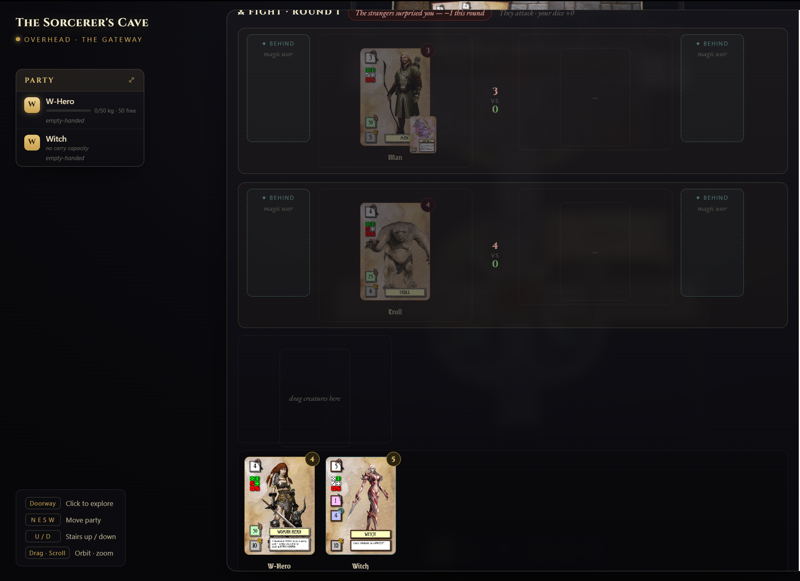

Yep, confirming the thoughts about the general principle that the game should only solicit player interaction when player input is actually necessary....
The "Drag Creatures Here" step is unnecessary in the below example.

Perhaps just a passive information message sequence, such as:
Pop Up - "The strangers are hostile - you must defend yourself!"  (As now)
followed by a very brief timed pause for the player to read that message (and feel the "dread"!),
then into the battle view with a message:
"The attackers have chosen their targets...."
and a button "Roll the Round".

Second Idea:
The "hand of cards across the bottom of the screen ( as I mentioned before should not scroll out of view) but also:
I really like the "floating" hand of cards on the front screen. I wonder - is there a way that (when the player does have selections and placement to make) the hand you see looks like that?
Flat, not curved I suppose, and obviously with the left-hand side stacking carried all the way across (not stacking the opposite way as per the right hand side) - so you can "at-a-glance" see all the critical numbers in a large hand. Could maybe get around the  issue of scrolling the hand view sideways or down when it's a huge battle. The stacked view could just shrink cards in size to fit the screen width - because dragging highlights the card to full size anyway before you tap it to select it?
Would work even with a face-to-face 3D battlefield above it too. 
